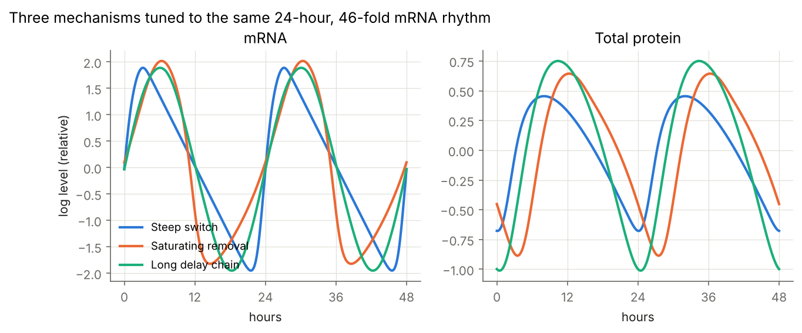
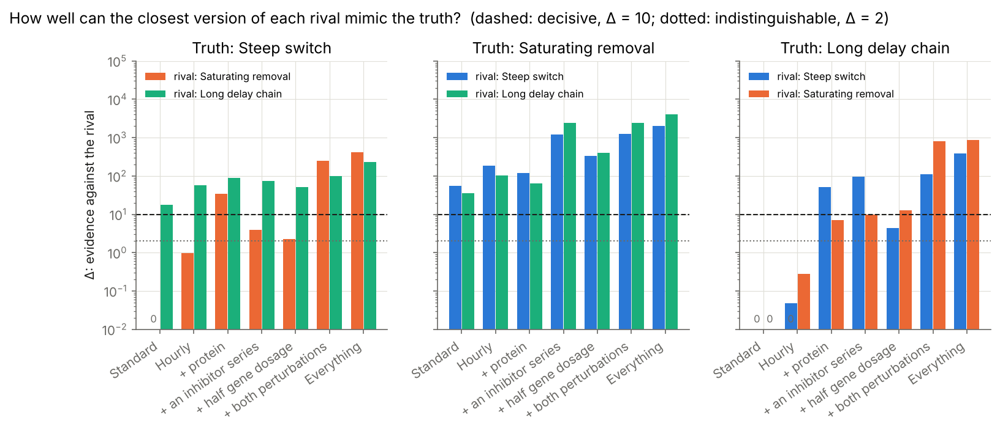
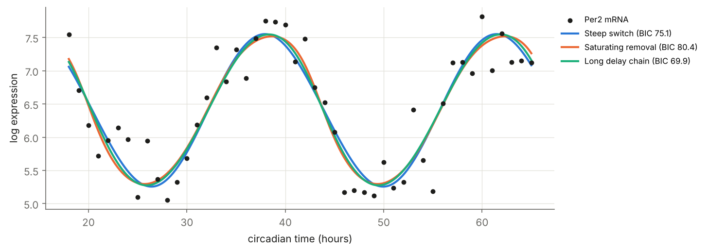
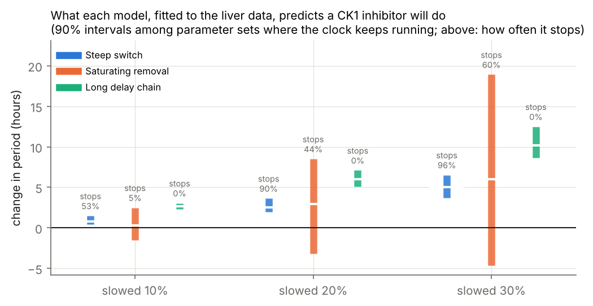

# Telling clocks apart

[](https://github.com/jackcormacwright1/telling-clocks-apart/actions/workflows/tests.yml)

**[Open the dashboard](https://telling-clocks-apart.streamlit.app/)**

The core of the circadian clock is a negative-feedback loop: PER and CRY proteins switch off their own genes.
A loop like that only keeps oscillating if the repression is strong and late enough, and there are three
textbook explanations of what supplies that: **very steep repression** (Goodwin, 1965; Griffith, 1968),
**saturating removal** of mRNA and protein (Bliss et al., 1982; Gonze et al., 2005), or **a longer chain of
delays** (Tyson and Othmer, 1978).
Each can be tuned to produce the same daily rhythm.

This project asks three questions of those models:

1. **Which experiment would tell them apart?** For each model taken as the truth, every rival is refitted to the
   truth's predictions for seven candidate experiments. What the best version of a rival still cannot mimic
   (T-optimal design) is the evidence the experiment would give.
2. **How much does a time course say about each model's parameters?** The Fisher information of each experiment
   shows which parameter combinations it pins down.
3. **What do real data say?** All three are fitted to hourly Per2 mRNA from mouse liver (Hughes et al., 2009),
   with posterior samples of every parameter set consistent with the data.



## Headline findings

1. **A standard time course cannot tell the models apart.** With mRNA measured every 4 hours for two days, if
   the delay chain is true then each rival can be tuned to reproduce its data to well within measurement noise,
   and the saturation model can do the same to the switch. The exception is when saturation is true: its
   waveform has a shape the others cannot make.
2. **More of the same data barely helps; different data does.** Sampling every hour, four times the effort,
   leaves the evidence against a mimicking rival at Δ ≤ 1 (2 is indistinguishable, 10 decisive). Adding protein,
   a drug or a mutant does far more.
3. **No single extra experiment is decisive whatever the truth, but two together are.** The best addition
   depends on which model is true: an inhibitor series if it is the delay chain, protein measurements if it is
   the switch. In the worst case the best single experiment gives only Δ = 7. Adding an inhibitor series *and*
   half gene dosage, two reporter experiments with no new time courses, gives Δ ≥ 100 against every rival:
   a rival can fake either result, but not both with the same parameters. In simulation with realistic noise,
   that pair ruled out both rivals in 60 of 60 data sets.
4. **Comparing models at fixed parameters misleads.** At its base parameters the saturation model predicts that
   slowing protein removal *shortens* the period, the opposite of the other two. That looks like a decisive
   test, but the version of it that best fits the switch's time course *lengthens* the period by almost
   exactly the switch's amounts.
5. **Each model is sloppy.** A standard time course pins down two combinations of parameters in each model,
   whatever its number of parameters: mainly the overall speed of the clock. In the switch, two combinations are
   not determined at all.
6. **Picking the simplest model is not evidence for it.** BIC chose the right model in 75 to 100% of simulated
   data sets even for experiments that could not tell the models apart, because the delay chain has the fewest
   parameters. The data themselves ruled out both rivals in 0% of those data sets.
7. **On real data, the same story.** All three fit two days of hourly *Per2* mRNA from mouse liver equally
   well, yet predict three different responses to a CK1 inhibitor. Only the delay chain's prediction matches,
   qualitatively, what the drug is known to do: lengthen the period in proportion to the dose without stopping
   the clock.

The models, methods, results and limitations are written up in [docs/METHODOLOGY.md](docs/METHODOLOGY.md).



## Real data

Hughes et al. (2009) sampled the livers of mice in constant darkness every hour for two days. All three models
fit the *Per2* mRNA time course equally well: their misfits are what noise alone would give. BIC prefers the
delay chain, but only because it has the fewest parameters.



Sampling every parameter set consistent with those data (four chains of adaptive Metropolis per model) and
running each under a drug that slows protein removal by 20%:

| | Steep switch | Saturating removal | Long delay chain |
|---|---:|---:|---:|
| Clock stops | 90% of parameter sets | 43% | 0% |
| Change in period, if it keeps running | +2.5 h (+2.0 to +3.6) | +3.0 h (−3.2 to +8.5) | +6.0 h (+5.1 to +7.1) |

The real CK1δ inhibitor PF-670462 lengthens the period in a dose-dependent way, up to about 8 hours in
tissues, and only stops the clock at the highest doses (Meng et al., 2010). That matches the delay chain. The
switch, fitted to the liver data, sits so close to the edge of oscillation that a mild inhibitor would usually
stop it. The comparison is qualitative, since how a drug dose maps onto "protein removal slowed by 20%" is
unknown. The saturation model's chains did not converge (R-hat 2.2), which is itself a finding: these data
leave its parameters, and its predictions, almost entirely open. Diagnostics and caveats are in
[METHODOLOGY](docs/METHODOLOGY.md#real-data).



## The dashboard

The dashboard is live at **[telling-clocks-apart.streamlit.app](https://telling-clocks-apart.streamlit.app/)**,
or run it locally with `streamlit run app.py`:

* **The models:** the three mechanisms, their rhythms, and how they respond to an inhibitor at their base
  parameters.
* **Explore a model:** change any parameter or perturbation and see the oscillation it produces, computed live.
* **Which experiment?** The evidence each experiment gives against each rival, and the simulation study.
* **What the data pin down:** the Fisher information spectrum and each parameter's precision, per experiment.
* **Real data:** the fits to the liver data and what each model predicts for a CK1 inhibitor.

## Run it yourself

```bash
pip install -e ".[dev,app,scripts]"
pytest                                  # tests: the models' dynamics, fitting, the sampler

python scripts/tune_models.py           # base parameter sets (already in models.py)
python scripts/run_design.py            # discrimination and Fisher information: about 25 minutes on 2 cores
python scripts/run_design.py --refine   # rerun every fit from more starting points: about 20 minutes
python scripts/run_simulation.py        # 420 noisy data sets, 1,260 fits: about 45 minutes
python scripts/make_figures.py

# the liver data come from GEO, not stored here (4.8 MB)
mkdir -p data
curl -o data/GSE11923_series_matrix.txt.gz \
  https://ftp.ncbi.nlm.nih.gov/geo/series/GSE11nnn/GSE11923/matrix/GSE11923_series_matrix.txt.gz
python scripts/fit_real_data.py         # fits and posterior chains: about 45 minutes on 2 cores

streamlit run app.py
```

## Layout

```
src/clocks/
  models.py       the three models, the integrator (numba), limit cycles, perturbations
  experiments.py  what each experiment measures, with what noise, and what each model predicts for it
  fit.py          least-squares fitting with profiled offsets, multi-start; Fisher information
  design.py       discrimination (Delta) and identifiability
  ensemble.py     posterior sampling (adaptive Metropolis), R-hat and effective sample size
scripts/          tune_models.py, run_design.py, run_simulation.py, fit_real_data.py, make_figures.py
app.py            the Streamlit dashboard
results/          results and charts
docs/             METHODOLOGY.md
```

## Data and references

* M. E. Hughes et al. (2009), Harmonics of circadian gene transcription in mammals, *PLoS Genetics* 5(4),
  e1000442. Data: GEO accession [GSE11923](https://www.ncbi.nlm.nih.gov/geo/query/acc.cgi?acc=GSE11923).
* B. C. Goodwin (1965), Oscillatory behavior in enzymatic control processes, *Advances in Enzyme Regulation* 3.
* J. S. Griffith (1968), Mathematics of cellular control processes I, *Journal of Theoretical Biology* 20.
* R. D. Bliss, P. R. Painter and A. G. Marr (1982), Role of feedback inhibition in stabilizing the classical
  operon, *Journal of Theoretical Biology* 97.
* D. Gonze, S. Bernard, C. Waltermann, A. Kramer and H. Herzel (2005), Spontaneous synchronization of coupled
  circadian oscillators, *Biophysical Journal* 89.
* D. Gonze and P. Ruoff (2020), The Goodwin oscillator and its legacy, *Acta Biotheoretica*,
  https://doi.org/10.1007/s10441-020-09379-8.
* J. J. Tyson and H. G. Othmer (1978), The dynamics of feedback control circuits in biochemical pathways,
  *Progress in Theoretical Biology* 5.
* A. C. Atkinson and V. V. Fedorov (1975), The design of experiments for discriminating between two rival
  models, *Biometrika* 62(1).
* R. N. Gutenkunst et al. (2007), Universally sloppy parameter sensitivities in systems biology models, *PLoS
  Computational Biology* 3(10), e189.
* Q.-J. Meng et al. (2010), Entrainment of disrupted circadian behavior through inhibition of casein kinase 1
  (CK1) enzymes, *PNAS* 107(34).

The code is MIT licensed.
