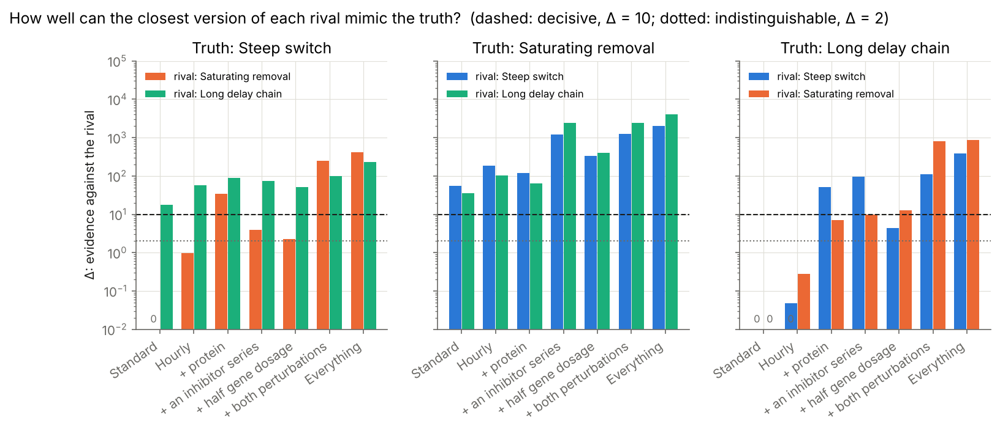
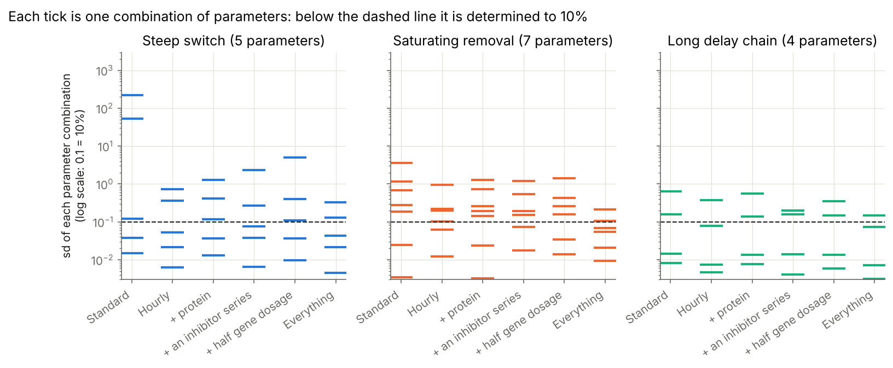
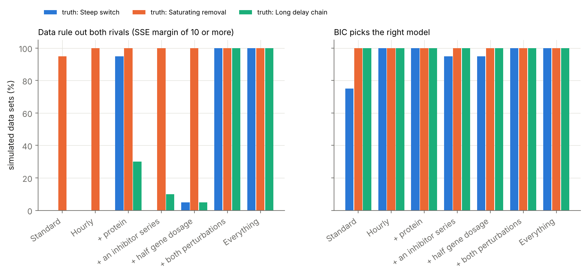
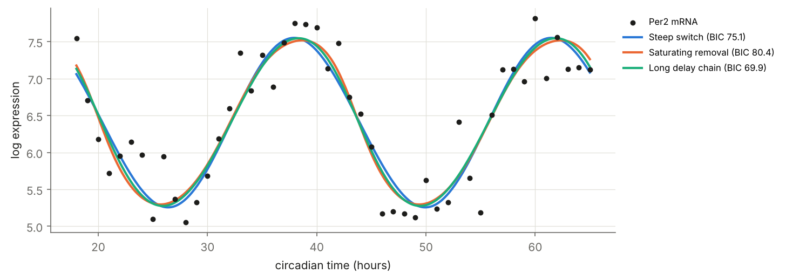
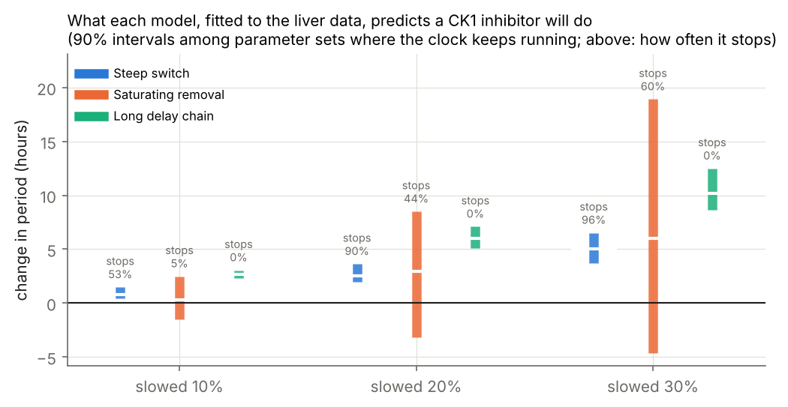

# Methodology

## The question

The core of the mammalian circadian clock is a negative-feedback loop: CLOCK and BMAL1 switch on the *Per*
and *Cry* genes, and the PER and CRY proteins, after a delay, switch them off again. A loop like this does not
oscillate automatically. Left to itself it settles to a steady level unless the repression is both strong and
late enough. There are three textbook explanations of what supplies that:

1. **Steep repression.** In Goodwin's model (1965) each stage is removed in proportion to its amount, and the
   loop only oscillates if repression is extremely cooperative: a Hill coefficient above 8 with three stages
   (Griffith, 1968), where molecular mechanisms rarely give more than 3 or 4 (Gonze and Ruoff, 2020).
2. **Saturating removal.** If the enzymes that degrade mRNA and protein saturate, removal is no longer
   proportional to amount, and the loop can oscillate with gentle repression, even none (Bliss et al., 1982).
   Gonze et al. (2005) used this version of the loop as their model of a single circadian cell.
3. **A longer delay.** With more intermediate steps between transcription and repression (phosphorylation,
   complex formation, nuclear entry), gentle repression is enough: with seven stages, a Hill coefficient above
   about 2.1 (the secant condition; Tyson and Othmer, 1978).

These are different claims about how the clock works, and they make different predictions about drugs and
mutations. But each can be tuned to produce the same daily rhythm. This project asks: **which experiment would
tell them apart?** And, within whichever model is right, **how much can the usual data say about its
parameters?**

## The models

For stages *i* = 1..*N*, with *x*<sub>1</sub> the mRNA and *x*<sub>N</sub> the repressor:

```
dx_1/dt = v / (1 + x_N^n) - removal_1(x_1)
dx_i/dt = k_i x_(i-1) - removal_i(x_i)          i = 2..N
```

| Model | Stages | Removal | Free parameters |
|---|---|---|---|
| Steep switch | 3 | r<sub>i</sub> x | three removal rates, Hill coefficient *n* (4 to 60), gain |
| Saturating removal | 3 | V<sub>i</sub> x / (K<sub>m</sub> + x) | transcription *v*, *n* (1 to 4), conversion rate *k*, three V<sub>i</sub>, K<sub>m</sub> |
| Long delay chain | 7 | r<sub>i</sub> x | mRNA removal rate, one rate for all six protein steps, *n* (1 to 4), gain |

Concentrations are in units where repression is half-maximal at *x*<sub>N</sub> = 1, and time is in hours. In
the two linear models each protein stage is made at the rate it is removed (*k*<sub>i</sub> = *r*<sub>i</sub>),
which only fixes the units of the intermediate stages, and *v* = gain × *r*<sub>1</sub>, so the gain is the level
the loop would reach without repression. Multiplying every rate by the same factor then speeds the clock up by
that factor and leaves the waveform unchanged.

The bounds on the Hill coefficient keep the hypotheses distinct. If the saturation model were allowed steep
repression, it would contain the switch as a special case (removal far below saturation is linear), and the
delay model would come close to it too. The question is what supplies the nonlinearity *when repression is not
steep*, so their Hill coefficients are limited to 4.

**Base parameters.** Each model has a base parameter set (`scripts/tune_models.py`) with a 24-hour period
and the same 47-fold peak-to-trough swing in mRNA (3.84 on the natural log scale). The saturation model is the
least flexible: it keeps oscillating through every perturbation in the experiments only in a band of parameters
where its amplitude hardly changes, so it was set by hand and the other two were tuned to match it, each by
bisection on its gain, then rescaled in time to exactly 24 hours. Matching the swing took a Hill coefficient of
20 in the switch, 2 with saturating removal and 3 with the delay chain. These base sets are the "truths" in the
design analysis and the simulation study.

**Perturbations.** Two stand for real experiments:

* an **inhibitor** multiplies the removal rate of every protein stage by *f*, as a CK1δ/ε inhibitor slows the
  phosphorylation-dependent degradation of PER (*f* = 0.9, 0.8 and 0.7 below);
* **half dosage** multiplies the transcription rate by 0.5, as in a heterozygous knockout.

**Computing the rhythm.** The equations are integrated by fourth-order Runge–Kutta with a step of 0.05 hours
(compiled with numba), until two successive cycles agree in period to 0.1% and the amplitude has stopped
shrinking. The period comes from the times log mRNA rises through its midpoint, interpolated between steps. If
the oscillation decays, or no cycle appears, the model is recorded as not oscillating. Starting each
integration from the cycle of a nearby parameter set makes repeated evaluations during fitting fast (about 4 ms
each).

## What is measured

Every experiment includes the **standard time course**: mRNA every 4 hours for two days (13 samples), each
with a measurement error of 0.15 on the log scale (about 15%). Levels are only known relative to an unknown
scale, as from a microarray or qPCR, so each time course has a free offset. The other experiments add to it:

| Experiment | Adds | Error |
|---|---|---|
| Hourly time course | mRNA every hour instead (49 samples) | 0.15 |
| Add protein | total protein (all stages after mRNA) at the same 13 times | 0.20 |
| Add an inhibitor series | period and amplitude of a reporter in control and at *f* = 0.9, 0.8, 0.7 | 0.25 h; 0.10 |
| Add half dosage | period and amplitude of a reporter in control and with transcription halved | 0.25 h; 0.10 |
| Everything | hourly mRNA, protein, the inhibitor series and half dosage | |

Period and amplitude measurements stand for luciferase recordings of cells or tissue slices, which give the
free-running period to within a fraction of an hour. Amplitude is recorded as the log of the perturbed
amplitude relative to the control.

## Fitting

With Gaussian measurement errors of known size, minus twice the log likelihood is the sum of squared
standardised residuals (SSE) plus a constant, so the best fit is a weighted least-squares fit. Parameters are
fitted on the log scale within each model's bounds, together with the phase of the clock at the first sample.
Each time course's offset is profiled out: for any parameters, the best offset is the mean difference between
data and prediction. Fits use scipy's trust-region reflective least squares with forward-difference
derivatives.

A model that does not oscillate where the data show a rhythm predicts flat time courses, and each rhythm
measurement it cannot predict adds a penalty of 20 standard deviations. This keeps the search away from
parameters that stop the clock without leaving the objective undefined there.

The objective has many local minima, so each fit runs from several starting points: the model's base
parameters, random draws around them (log-normal, sd 0.5) and, where available, the model's fits to related
data. Every start is first rescaled in time to the period seen in the data and given the best phase on a grid.

Models are compared by BIC = SSE + *k* log *n*, where *k* counts the model's parameters, the phase and the
offsets, and *n* is the number of observations.

## Which experiment tells the models apart?

**The criterion.** Take one model as the truth and compute exactly what it predicts for an experiment (at an
arbitrary phase, with no noise). Fit each rival to those predictions. The rival's best SSE, **Δ**, is how far the
closest version of the rival still misses, in units of measurement variance. This is the T-optimality criterion
of Atkinson and Fedorov (1975). Its meaning is practical: with real noise, the rival's SSE exceeds the truth's by
about Δ on average (less a little for each extra parameter the rival has). So Δ is the evidence the experiment
is expected to give against the rival. Below about 2 the two are indistinguishable. Above about 10 (a
likelihood ratio near 150) the rival is decisively rejected. Repeating an experiment doubles its Δ.

Refitting is the point. Comparing the models at their base parameters says how different those three
parameter sets are. Δ says what *no* setting of the rival's parameters can mimic.

**Search.** A local minimum would make a rival look worse than it is and overstate Δ, so every fit was run from
the rival's base parameters, six random starts around them, and the rival's fits to every other experiment.
A second, independent pass then reran all 42 fits from twelve more widely spread starts
(`run_design.py --refine`). It improved most fits by less than 0.2. The largest change was the saturation
model's fit to the delay chain's half-dosage experiment, from 22.7 to 12.7. That is a reminder that each Δ is an
upper bound, found by search, on the true minimum.

**Results** ([discrimination.csv](../results/discrimination.csv)):

| Truth → rival | Standard | Hourly | + protein | + inhibitor | + half dosage | + both perturbations | Everything |
|---|---:|---:|---:|---:|---:|---:|---:|
| Switch → saturation | 0.0 | 1.0 | 34 | 4.0 | 2.2 | 250 | 421 |
| Switch → delay | 18 | 58 | 88 | 74 | 51 | 100 | 230 |
| Saturation → switch | 56 | 185 | 118 | 1,208 | 334 | 1,240 | 2,012 |
| Saturation → delay | 35 | 103 | 65 | 2,420 | 396 | 2,391 | 3,981 |
| Delay → switch | 0.0 | 0.0 | 51 | 94 | 4.4 | 112 | 390 |
| Delay → saturation | 0.0 | 0.3 | 7.0 | 9.8 | 12.7 | 810 | 861 |
| **Worst case** | **0.0** | **0.0** | **7.0** | **4.0** | **2.2** | **100** | **230** |



What this shows:

1. **A standard time course cannot tell the models apart**, unless the saturation model happens to be true.
   If the truth is the delay chain, some version of each rival reproduces its mRNA time course to well within
   the noise (Δ < 0.01), and the same holds for the saturation model mimicking the switch.
2. **More of the same data barely helps.** Sampling every hour (four times the effort) leaves Δ at 1 or below in
   all three hard cases.
3. **The best single addition depends on which model is true.** If the delay chain is true, the inhibitor series
   is best (Δ ≥ 9.8, just short of decisive). If the switch is true, the saturation model can mimic the inhibitor
   series (Δ = 4.0) and half dosage (2.2), and only protein measurements separate them (34). No single addition
   is decisive whatever the truth. The best worst case is protein, at Δ = 7.
4. **Two perturbations together are decisive, though either alone can be faked.** Adding both reporter
   experiments, with no new time courses, gives Δ of at least 100 against every rival. A rival can find
   parameters that match the inhibitor series, or parameters that match half dosage, but not one set that matches
   both. For example, the saturation model's best mimic of the switch's inhibitor series predicts that halving
   transcription shortens the period to 15.8 hours, where the switch says 22.3.
5. **Comparing models at fixed parameters misleads.** At its base parameters the saturation model predicts that
   slowing protein removal *shortens* the period, the opposite of the other two
   ([perturbations.png](../results/perturbations.png)). That looks like a decisive qualitative test. But the
   version of the saturation model that best fits the switch's standard time course predicts the inhibitor
   *lengthens* the period, by almost exactly the switch's amounts (26.3, 28.6 and 30.6 hours against 26.1, 28.6
   and 31.5).

## What does a time course say about the parameters?

Within one model, the Fisher information of the log parameters at the truth says how precisely each
combination of parameters is determined. It is computed from the Jacobian of the standardised residuals
(forward differences), with the phase profiled out by a Schur complement and the offsets already profiled out of
the residuals. Each eigenvalue λ corresponds to a combination of log parameters (its eigenvector) determined to a
standard deviation of 1/√λ. A combination with sd below 0.1 is determined to within about 10%.



| Combinations determined to 10% | Standard | Hourly | + protein | + inhibitor | + half dosage | + both | Everything |
|---|---:|---:|---:|---:|---:|---:|---:|
| Steep switch (5 parameters) | 2 | 3 | 2 | 3 | 2 | 3 | 3 |
| Saturating removal (7) | 2 | 3 | 2 | 3 | 3 | 4 | 5 |
| Long delay chain (4) | 2 | 3 | 2 | 2 | 2 | 2 | 3 |

All three models are **sloppy** in the sense of Gutenkunst et al. (2007): the eigenvalues spread over three to
eight orders of magnitude. A standard time course pins down two combinations in each model, whatever its number
of parameters. The best-determined is always the overall speed of the clock (every rate moving together, which
sets the period). In the switch, two combinations are not determined at all (sd 54 and 220 on the log scale):
one is the gain, with the Hill coefficient, because far above the threshold for oscillation the switch is simply
on or off; the other is the ratio of the two protein removal rates, because mRNA data cannot say which of the two
protein stages is the slow one. Hourly sampling resolves both (sd 0.36 and 0.73). Even with every experiment, two
of the switch's five combinations and two of the saturation model's seven stay above 10%.

This is why the design question had to be asked by refitting rivals rather than by perturbing parameters: in
directions the data do not determine, a model can wander far from its base parameters, and its predictions for
an untested experiment wander with it.

## With noise: a simulation study

Δ is an expectation. To see what happens with real noise, `run_simulation.py` generated 20 noisy data sets for
each model as the truth and each experiment, with the noise levels above and the clock at a random phase at
the first sample, and fitted all three models to each (420 data sets, 1,260 fits). Each fit started from the
model's best fit to the truth's noise-free data (for the true model, its own parameters) and from its base
parameters. Starting rivals at their best mimic of the truth, if anything, helps them, so it cannot make the
truth look better than it is.

Two measures, because they answer different questions:

* **Decisive**: the truth fits better than both rivals by at least 10 in SSE, so the data themselves rule the
  rivals out.
* **BIC picks the truth.** BIC adds a penalty of log *n* per parameter, so when the three fit equally it picks
  the one with fewest parameters: the delay chain (4), then the switch (5), then saturation (7).



| Decisive (% of 20) | Standard | Hourly | + protein | + inhibitor | + half dosage | + both | Everything |
|---|---:|---:|---:|---:|---:|---:|---:|
| Truth: steep switch | 0 | 0 | 95 | 0 | 5 | 100 | 100 |
| Truth: saturating removal | 95 | 100 | 100 | 100 | 100 | 100 | 100 |
| Truth: long delay chain | 0 | 0 | 30 | 10 | 5 | 100 | 100 |

The noisy experiments behave as Δ predicts. With the standard or hourly time course the data never rule out the
rivals unless saturation is true. Protein measurements are decisive 95% of the time if the switch is true but
only 30% if the delay chain is. Either perturbation alone rarely is. Both together always are. In no data set
did a rival beat the truth by 10 or more, which would have meant the truth's fit had failed.

BIC, meanwhile, picks the right model in 75 to 100% of data sets under *every* experiment, including the
standard time course. That is the Occam penalty doing the work. When the delay chain is true and the data
cannot distinguish the models, BIC picks it because it has the fewest parameters, and the same logic favours
the switch over saturation. Those are correct guesses for the wrong reason. Had the truth been the model with
more parameters, the same indistinguishable data would have pointed to the wrong one. Being right about which
model is simplest is not evidence about which mechanism the clock uses.

## Real data

**Data.** Hughes et al. (2009) entrained male C57BL/6J mice to 12 hours of light and 12 of dark for a week,
moved them to constant darkness, and collected livers every hour from circadian time 18 to 65: 48 arrays on the
Affymetrix Mouse Genome 430 2.0 (GEO GSE11923). *Per2* has two probe sets on that array (MGI:1195265). One,
1417602_at, is strongly expressed and rhythmic, with a 16-fold range. The other sits near background, so
1417602_at is used. The series matrix holds expression on a linear scale, which is logged here.

**Noise.** Measurement error is estimated from the residuals of a harmonic regression (24-, 12- and 8-hour
components and a linear trend), which describes a smooth rhythm without assuming any of the three models. The
residual sd is 0.36 on the natural log scale (about ±44% per sample), and is then treated as known.

**Fits** ([real_fit.png](../results/real_fit.png)). Each model was fitted from its base parameters and ten
random starts.

| | Steep switch | Saturating removal | Long delay chain |
|---|---:|---:|---:|
| SSE (48 points) | 48.0 | 45.6 | 46.6 |
| BIC | 75.1 | 80.4 | 69.9 |
| BIC weight | 0.07 | < 0.01 | 0.93 |
| Period | 23.5 h | 23.7 h | 23.6 h |
| Hill coefficient | 23 | 3.7 | 3.1 |



All three fit equally well, and all three misfits are what noise alone would give with 39 to 42 residual
degrees of freedom. The BIC weights come entirely from the parameter penalty. By the simulation study's lesson,
they are not evidence about the mechanism. The fitted swing is about 10-fold (2.2 to 2.3 on the log scale),
smaller than the 47-fold base sets. The switch needs a Hill coefficient of 23 to match it.

**Posterior samples.** Each model's posterior was sampled with a flat prior on the log parameters within their
bounds (and on the phase) and the Gaussian likelihood above. Sampling used adaptive Metropolis (Haario et al.,
2001): during burn-in the proposal follows the chain's covariance and its size is tuned towards 23% acceptance,
then it is frozen. There were four chains of 60,000 steps per model, each started at the best fit, with the
first 20,000 steps discarded and 250 draws kept from each. Every draw was then run under the inhibitor series and
half dosage.

Diagnostics matter here, because these posteriors are exactly the sloppy, curved shapes that make sampling hard:

* **Delay chain:** split R-hat at most 1.04 and effective sample size at least 74 for every parameter. Converged.
* **Steep switch:** R-hat up to 1.35 on some parameters, but the chains agree on the predictions (R-hat 1.03 for
  whether the inhibitor stops the clock; effective sample size 300 for its effect on the period).
* **Saturating removal:** R-hat 2.2. The chains did not agree: one put the chance that the inhibitor stops the
  clock at 10%, another at 93%. Its posterior has regions the sampler could not move between, so its intervals
  understate the uncertainty.

**Predictions for a CK1 inhibitor** ([real_predictions.csv](../results/real_predictions.csv)). These are taken
over every parameter set consistent with the liver data, not just the best fit:

| Protein removal slowed by 20% | Steep switch | Saturating removal | Long delay chain |
|---|---:|---:|---:|
| Clock stops | 90% of draws | 43% | 0% |
| Change in period, if it keeps running (median, 90% interval) | +2.5 h (+2.0 to +3.6) | +3.0 h (−3.2 to +8.5) | +6.0 h (+5.1 to +7.1) |



The same time course, fitted equally well, leaves the three models predicting three different things. The delay
chain says the drug will lengthen the period, by an amount that grows with the dose (2.7, 6.0 and 10.1 hours at
10, 20 and 30%), and never stop the clock. The switch says even a mild inhibitor will usually stop it, because
fitted to these data it sits close to the edge of oscillation. The saturation model cannot say whether the
period will get longer or shorter, and often says the clock will stop.

**Against what is known.** The CK1δ inhibitor PF-670462 lengthens the circadian period in a dose-dependent way.
Meng et al. (2010) found it extended the period of PER2::luciferase fibroblasts to 33 hours at 1 µM, with rhythms
lost only at 2.5 µM and above, and lengthened the period of the brain's master clock (the SCN) and of other
tissues by up to about 8 hours. Robust, graded lengthening without arrest is what the delay chain predicts. The
switch, fitted to the liver data, predicts arrest under mild inhibition. This comparison is qualitative: the
mapping from a drug concentration to "protein removal slowed by 20%" is unknown, the measurements are in other
tissues, and a real CK1 inhibitor slows particular phosphorylation steps rather than every protein stage
equally. But it shows the point of the project in miniature. The time course alone could not choose between
the models, while the known response to one perturbation, which a modeller could have predicted in advance,
favours one of them.

**Half dosage** splits them too. The delay chain says a heterozygote would lose its rhythm in 47% of plausible
parameter sets, the switch in 12% and the saturation model in 96%.

## Limitations

* **One loop, one gene.** The mammalian clock has interlocking loops (BMAL1/CLOCK, PER/CRY, REV-ERB/ROR), and the
  liver clock is also driven by the brain's clock and by feeding. These models are the classic caricatures of
  the core loop, useful for asking what kind of nonlinearity it needs, not descriptions of the liver.
* **Δ is local.** It is computed at one parameter set for each truth. A different truth parameter set could make
  a different experiment best. Bayesian or maximin designs average or guard over the truth's parameters; this
  project guards only over which model is true.
* **The noise levels are assumptions.** The design results scale with them: halving every error quadruples every
  Δ. The ranking of experiments is less sensitive than the values.
* **Perturbations are idealised.** The inhibitor multiplies the removal rate of every protein stage by the same
  factor, and half dosage exactly halves transcription. A real drug acts on some steps more than others, and
  heterozygous animals can compensate.
* **Δ is found by search**, so it is an upper bound on the true minimum. Two independent passes from many starting
  points changed most values by less than 0.2, but cannot rule out a better fit somewhere unexplored.
* **The Fisher information is a local, linear approximation.** For directions it says are undetermined, the true
  posterior can be bounded, curved or multimodal. The posterior sampling for the real data does not make that
  approximation.
* **The simulation uses 20 data sets per cell**, so each percentage has a standard error of up to 11 points.

## References

* Atkinson, A. C. and Fedorov, V. V. (1975). The design of experiments for discriminating between two rival
  models. *Biometrika* 62(1), 57–70.
* Bliss, R. D., Painter, P. R. and Marr, A. G. (1982). Role of feedback inhibition in stabilizing the classical
  operon. *Journal of Theoretical Biology* 97, 177–193.
* Gelman, A. et al. (2013). *Bayesian Data Analysis*, 3rd edition. CRC Press. (Split R-hat, section 11.4.)
* Gonze, D., Bernard, S., Waltermann, C., Kramer, A. and Herzel, H. (2005). Spontaneous synchronization of coupled
  circadian oscillators. *Biophysical Journal* 89, 120–129.
* Gonze, D. and Ruoff, P. (2020). The Goodwin oscillator and its legacy. *Acta Biotheoretica*.
  https://doi.org/10.1007/s10441-020-09379-8
* Goodwin, B. C. (1965). Oscillatory behavior in enzymatic control processes. *Advances in Enzyme Regulation* 3,
  425–438.
* Griffith, J. S. (1968). Mathematics of cellular control processes I. Negative feedback to one gene. *Journal of
  Theoretical Biology* 20, 202–208.
* Gutenkunst, R. N. et al. (2007). Universally sloppy parameter sensitivities in systems biology models. *PLoS
  Computational Biology* 3(10), e189.
* Haario, H., Saksman, E. and Tamminen, J. (2001). An adaptive Metropolis algorithm. *Bernoulli* 7(2), 223–242.
* Hughes, M. E. et al. (2009). Harmonics of circadian gene transcription in mammals. *PLoS Genetics* 5(4),
  e1000442. Data: GEO GSE11923.
* Meng, Q.-J. et al. (2010). Entrainment of disrupted circadian behavior through inhibition of casein kinase 1
  (CK1) enzymes. *PNAS* 107(34), 15240–15245.
* Tyson, J. J. and Othmer, H. G. (1978). The dynamics of feedback control circuits in biochemical pathways.
  *Progress in Theoretical Biology* 5, 1–62.
